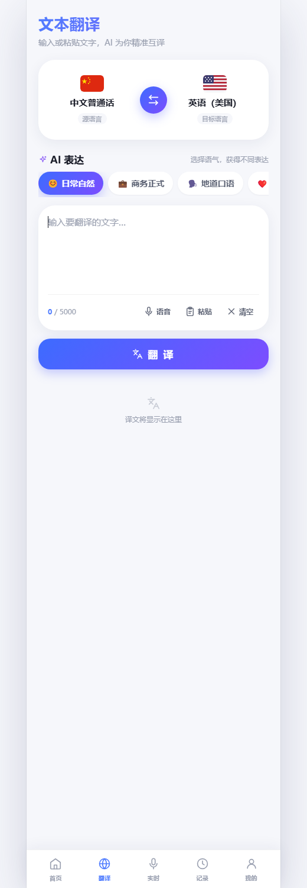
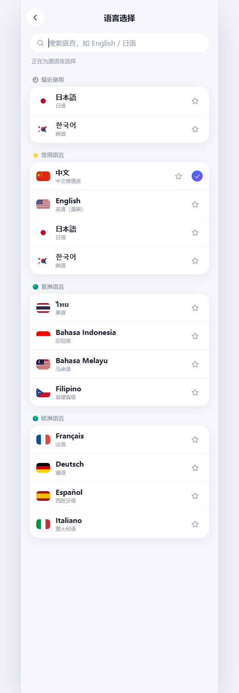

# 译境 TransVerse

> 听懂世界，自由表达 · 打开网页就能用的移动端翻译应用

[](https://wwllljj246-eng.github.io/transverse/)
[](https://developer.mozilla.org/zh-CN/docs/Web/JavaScript/Guide/Modules)
[](https://wwllljj246-eng.github.io/transverse/)
[](https://wwllljj246-eng.github.io/transverse/)
[](https://github.com/wwllljj246-eng/transverse)

<p align="center">
  
  
</p>

一个**零框架、零构建**的移动端 Web 翻译应用：原生 ES Modules + Hash 路由 + CSS 设计系统，手机浏览器打开即用。文本翻译已接入**真实机器翻译**，其余展示型能力用本地 Mock 驱动；失败时明确提示并降级，不把假译文伪装成真实结果。

---

## 在线体验

| 版本 | 地址 | 说明 |
| --- | --- | --- |
| 🌐 GitHub Pages | https://wwllljj246-eng.github.io/transverse/ | 推荐分享；静态前端 + 跨域调用下方后端，真实翻译可用 |
| ⚙️ CloudStudio 完整版 | https://e36145bc87da40faa42fbb52ad4d8e43.codebuddy.cloudstudio.run | 前端与 Express 后端同源，含拍照 OCR 接口 |

> GitHub Pages 是纯静态托管，本身跑不了后端；页面会自动把翻译请求发到带 HTTPS 的后端代理。若后端休眠或公共翻译额度用尽，会提示「翻译服务不可用，当前使用演示翻译」并降级，不会把假译文当作真实结果。

## 亮点

- **真实翻译**：腾讯云机器翻译 TMT 优先，免费额度耗尽时自动切到免密钥公共翻译（MyMemory），返回真实译文并标注通道。
- **六大场景**：文本翻译、拍照翻译、AI 同声传译、实时转写、面对面对话、悬浮字幕。
- **12 种语言**：中 / 英 / 日 / 韩 / 泰 / 印尼 / 马来 / 菲律宾 / 法 / 德 / 西 / 意，支持搜索、最近使用与收藏。
- **移动端优先**：375×812 设计基准、深浅双主题（跟随系统 + 手动）、三档字号、自定义底部 TabBar。
- **真实浏览器能力**：语音输入（SpeechRecognition）、朗读（speechSynthesis）、复制、系统分享、localStorage 持久化。
- **密钥不进前端**：云厂商凭证只存在于后端 `.env`；前端只发送 `{ text, from, to }`。
- **零依赖前端**：不需要 npm install、不需要打包，任意静态服务器即可运行。

## 功能与真实性一览

| 功能 | 路由 | 状态 |
| --- | --- | --- |
| 文本翻译 | `#/translate` | ✅ 真实机器翻译（TMT / MyMemory 双通道），失败降级演示译文并提示 |
| 语音输入、朗读、复制、分享 | `#/translate` | ✅ 浏览器原生 API |
| 历史 / 收藏 / 转写记录 | `#/history` 等 | ✅ localStorage 真实持久化 |
| 深浅主题 / 字号 / 语言偏好 | `#/settings/*` | ✅ 真实设置与持久化 |
| 拍照翻译 | `#/feature/camera` | 🎬 演示：取景框与识别卡为 Mock（后端 OCR 接口已实现，前端未接入） |
| 同声传译 / 实时转写 / 面对面对话 / 悬浮字幕 | `#/feature/*` | 🎬 演示：预置脚本逐字输出 |
| 离线包 / AI 整理等 | — | 🎬 演示数据 |

> 除文本翻译外，标注「🎬 演示」的能力均为本地模拟，本项目刻意区分真实与模拟，详见 `docs/DELIVERY.md`。

## 真实翻译如何工作

```
浏览器（GitHub Pages / CloudStudio / 本地）
   │ POST /api/translate { text, from, to }
   ▼
Express 后端（server.js）
   ├─ ① 腾讯云 TMT（需密钥，按月免费额度）
   └─ ② 额度耗尽或失败 → MyMemory 公共接口（免密钥，匿名每日配额）
   ▼ 返回真实译文；全部失败 → 502，前端降级 mockTranslate 并提示
```

- 后端通过 CORS 白名单允许 `https://wwllljj246-eng.github.io` 调用，并处理 OPTIONS 预检。
- GitHub Pages 前端在 `js/data/translation-mock.js` 中检测 `github.io` 域名，自动指向后端；也可在页面设置 `window.TRANSVERSE_API_BASE` 换成自己的后端。
- 长文本按 400 字分块请求；接口有 IP 频控（默认 12 次/分钟）。

**隐私**：使用兜底通道时，待翻译文本会发送给第三方公共服务 MyMemory，请勿输入敏感或隐私内容。历史、收藏与设置只保存在浏览器 localStorage，不上传服务器。

## 快速开始

静态前端（演示翻译，无需 Node）：

```bash
python -m http.server 8137
# 或 npx serve -p 8137
# 打开 http://localhost:8137/
```

完整版（含真实翻译后端）：

```bash
npm install
npm start          # node server.js，默认 http://localhost:8137/
```

可选：复制 `.env.example` 为 `.env` 填入腾讯云密钥，启用 TMT 主通道；不填也能用免密钥兜底通道。`.env` 已被 `.gitignore` 忽略，**切勿提交密钥**。

## 部署

| 方式 | 做法 | 适用 |
| --- | --- | --- |
| GitHub Pages | 本仓库 `main` 分支 `/(root)` 已开启 Pages，`.nojekyll` 禁用 Jekyll | 分享与展示，前端静态 |
| CloudStudio / 任意 Node 主机 | `PORT=8080 node server.js`，依赖 `express` | 前后端同源、真实翻译 |
| CloudBase 云托管 | `Dockerfile` + `cloudbaserc.json`（填入自己的 envId） | 容器化长期运行 |

> 更换后端地址后，记得同步修改前端 `REMOTE_API_BASE`（或注入 `window.TRANSVERSE_API_BASE`）以及后端 `ALLOWED_ORIGINS` 白名单。

## 后端 API

| 接口 | 请求 | 响应 |
| --- | --- | --- |
| `POST /api/translate` | `{ "text": "hello", "from": "en-US", "to": "zh-CN" }` | `{ ok, from, to, text, provider }` |
| `POST /api/ocr-translate` | `{ "image": "dataURL/base64", "from", "to" }` | OCR 文本行 + 译文 + 百分比坐标 |
| `GET /api/health` | — | `{ ok, service, configured }` |

环境变量：`TENCENT_SECRET_ID`、`TENCENT_SECRET_KEY`、`TENCENT_REGION`、`PORT`、`RATE_LIMIT`。

## 目录结构

```
transverse/
├── index.html            # 入口（主题/字号预置脚本、SEO / OG 元信息）
├── css/                   # 设计令牌 + 各域样式（9 个文件）
├── js/
│   ├── main.js            # 应用引导
│   ├── router.js          # Hash 路由（16 条）
│   ├── components/        # 通用 UI 组件
│   ├── pages/             # 每页一个模块
│   ├── data/              # Mock 数据层 + 真实翻译入口
│   └── utils/             # DOM / 格式化工具
├── server.js              # Express：静态托管 + 翻译 / OCR 代理
├── Dockerfile             # CloudBase 云托管镜像
├── cloudbaserc.json       # 云托管配置（需填 envId）
├── .env.example           # 环境变量示例（不含真实密钥）
├── docs/screenshots/      # 界面截图
└── docs/DELIVERY.md       # 原始交付文档与工程约定
```

## 已知限制

- 拍照翻译、同传、转写、对话、字幕仍是演示流程；后端 OCR 接口已就绪但前端未接入。
- 腾讯云 TMT 免费额度按月重置，耗尽后自动走 MyMemory；MyMemory 匿名调用有每日配额，超过会降级。
- CloudStudio 沙箱可能休眠，后端暂时不可达时页面会明确提示并降级。
- 语言对覆盖 12 种内部语言码，个别小语种在两个通道都可能不支持，接口会明确报错。

## 参与

欢迎 Star / Fork / 提 Issue：https://github.com/wwllljj246-eng/transverse/issues

前端零构建，改完 HTML/CSS/JS 刷新即可看到效果；后端改动需重启 `node server.js`。

## 许可

暂未声明开源许可证，当前仅用于演示与学习；如需商用或再分发请联系仓库作者。
